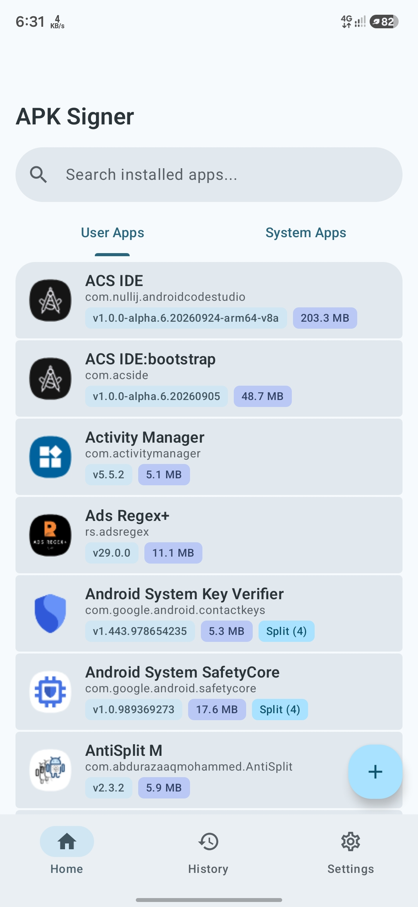
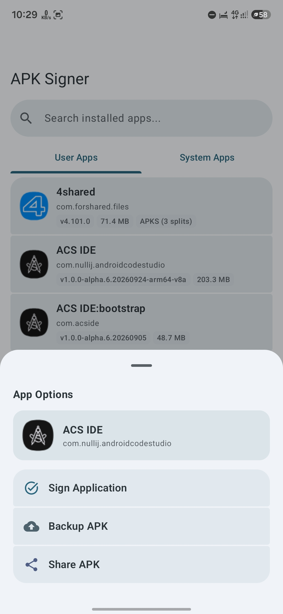
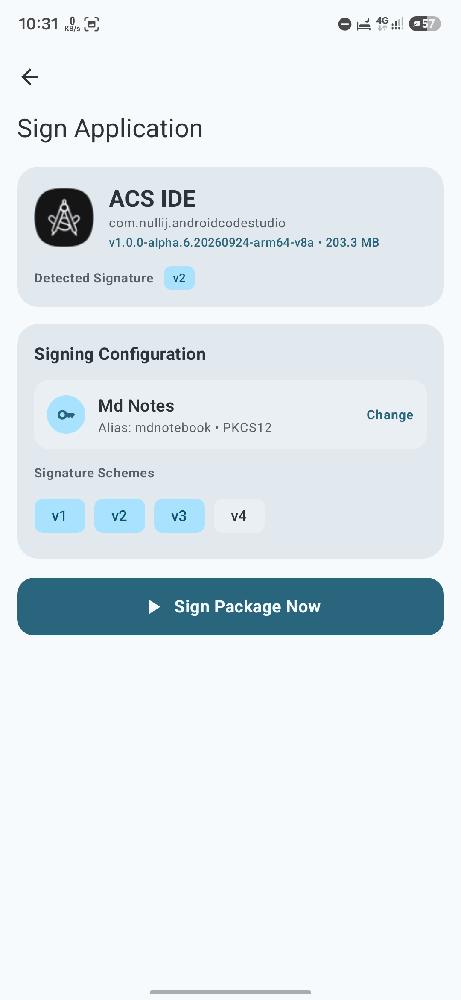
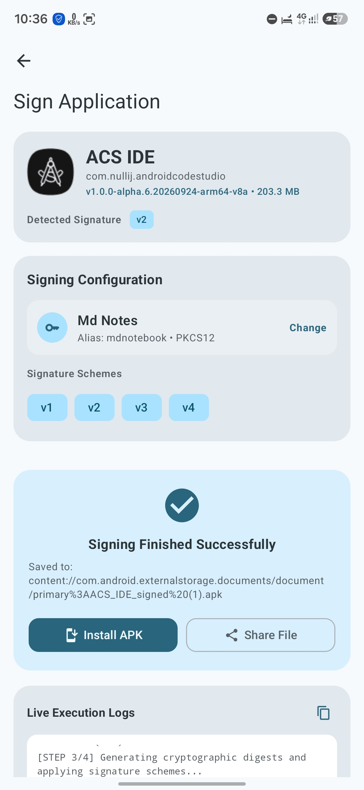
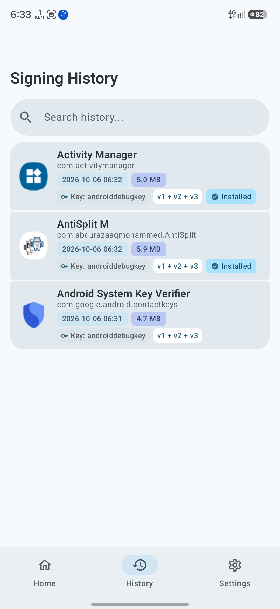
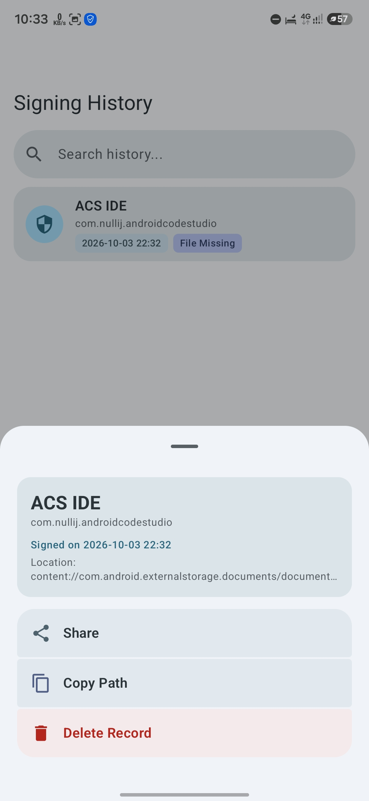
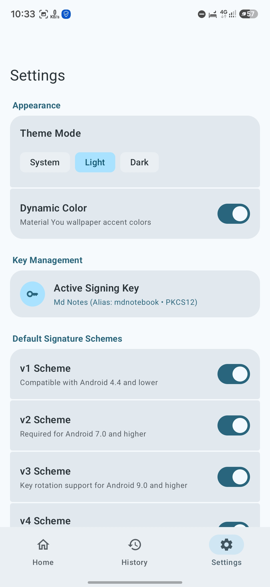
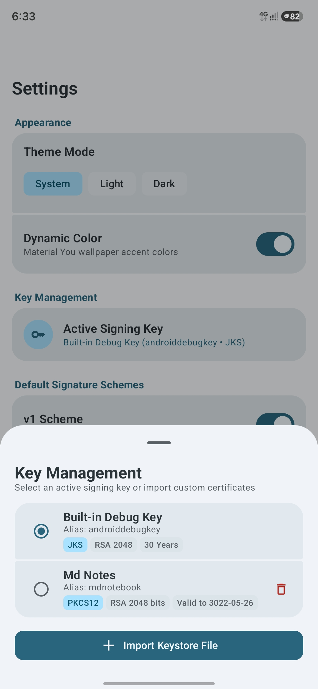

# APK Signer Pro

### Sign Android APKs Easily & Securely

An open-source Android toolkit for signing, verifying, extracting, backing up, and managing APK packages directly on your device.

---

## ✨ Key Features

APK Signer Pro combines advanced APK signing capabilities with a modern interface built using Kotlin and Jetpack Compose.

### 🔐 APK Signing & Verification

- **v1 APK Signing:** Legacy JAR-based APK signing for older Android versions.
- **v2 APK Signing & Verification:** Full-file binary integrity protection for Android 7.0+.
- **v3 APK Signing & Verification:** Key rotation and cryptographic lineage support for Android 9.0+.
- **v4 APK Signing:** Streaming signature generation with `.apk.idsig` support for Android 11.0+.
- **16KB & 4KB Page Alignment:** Aligns native `.so` libraries and `resources.arsc` for modern Android compatibility.
- **Multi-Format Keystores:** Supports `JKS`, `PKCS12`, `BKS`, `BKS-V1`, `UBER`, and `BCFKS`.
- **Built-in Debug Key:** Quickly sign applications using standard Android Studio debug credentials.
- **Certificate Inspection:** View certificate algorithm, validity, subject, issuer, and SHA-256 fingerprint.
- **Persistent Credentials:** Save key associations for faster signing without repeated prompts.

### 📦 APK & Package Management

- **APK Backup & Extraction:** Back up and extract APKs from installed user and system applications.
- **Split APK Support:** Handle split APK packages and `.apks` files.
- **XAPK Support:** Work with XAPK packages alongside standard APK and APKS files.
- **APK Management:** Install, share, copy paths, and remove generated packages.
- **Signing History:** Keep track of previous signing operations.
- **Search & Filtering:** Quickly find records and installed applications.
- **Organized Storage:** Automatically organize signed packages and backups.

### 💾 Storage & File Handling

- **Reactive Local Storage:** SQLite persistence with Kotlin Flow.
- **Secure File Handling:** Uses Android's `FileProvider` and system sharing mechanisms.

---

## 🎨 Material 3 Expressive UI

APK Signer Pro features a modern interface designed around Material 3 Expressive principles.

- **Material 3 Expressive:** Modern interface built entirely with Jetpack Compose.
- **Dynamic Colors:** Adapts to the system wallpaper color palette.
- **Light & Dark Themes:** Supports system-based theme modes.
- **Expressive Loading Indicators:** Smooth loading indicators across different screens and actions.
- **Pull-to-Refresh:** Expressive swipe-to-refresh interactions.
- **Collapsing Top App Bars:** Smooth nested scrolling across primary screens.
- **Live Logs:** Colorized signing and execution logs with step indicators.
- **One-Tap Log Copying:** Quickly copy logs to the clipboard.
- **Consistent Empty States:** Clean and polished empty-state layouts.
- **Responsive Layouts:** Designed for a consistent experience across Android devices.
- **Multi-language Support:** Available in English, Chinese, Russian, Portuguese, French, Spanish, German, and Arabic.

---

## 📸 Screenshots

---

## ☕ Support the Project

If APK Signer Pro is useful to you, you can support its continued development by buying me a coffee.

 

---

## 🙏 Acknowledgements

Special thanks to the **ACS Lite team** for making Android development possible directly on mobile.

This project was developed using ACS Lite, allowing the entire application to be built on an Android device without a computer.

 

---

## 📄 License

This project is licensed under the Apache 2.0 License.
